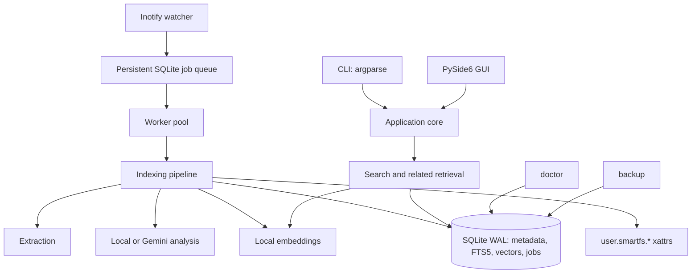
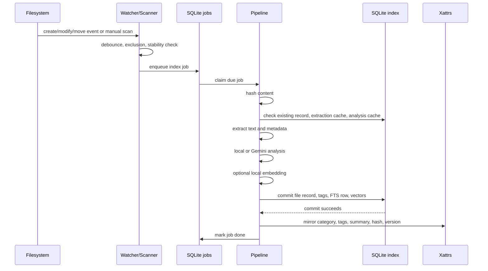
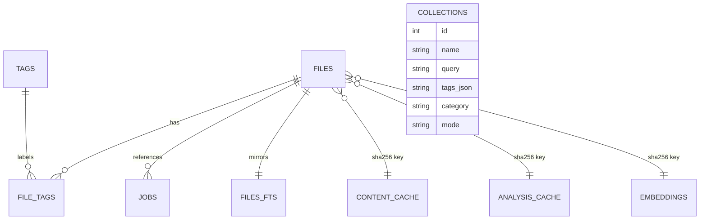
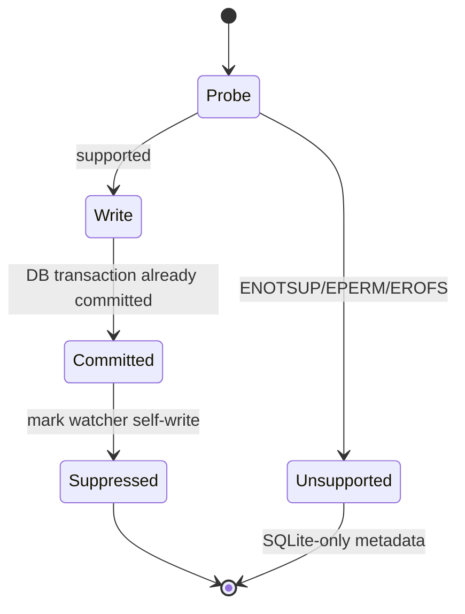

# SmartFS

## A Linux-Native Semantic File Manager with Extended-Attribute Metadata and Hybrid Search

### Project Report

| Field | Details |
| --- | --- |
| Project title | SmartFS: A Linux-Native Semantic File Manager |
| Student name | [Your Name] |
| Roll number | [Roll Number] |
| Course | [Course Name / Course Code] |
| Programme | [Degree / Branch / Semester] |
| Institution | [Institution Name] |
| Supervisor | [Supervisor Name] |
| Academic year | [Academic Year] |
| Report date | [Date] |
| Project version | 0.7.0 |
| Repository root | `smartfs/` |

---

## Declaration

I hereby declare that this project report entitled **“SmartFS: A Linux-Native Semantic File
Manager with Extended-Attribute Metadata and Hybrid Search”** is my own work, carried out
under the guidance of my supervisor. The implementation, testing, and documentation
presented here are original unless otherwise acknowledged. Sources of ideas, libraries, and
external documentation have been cited in the References section. This work has not been
submitted for any other academic award.

Place: [Place]  
Date: [Date]  
Signature: ____________________  
Name: [Your Name]

---

## Certificate

This is to certify that **[Your Name]**, bearing roll number **[Roll Number]**, has
satisfactorily completed the project **“SmartFS: A Linux-Native Semantic File Manager”**
under my supervision during the academic year **[Academic Year]**. The report has been
examined and is recommended for evaluation as part of the requirements of **[Course Name /
Course Code]**.

Supervisor: ____________________  
Designation: ____________________  
Department: ____________________  
Institution: ____________________  
Date: ____________________

---

## Acknowledgement

I express my sincere gratitude to my project supervisor, **[Supervisor Name]**, for the
guidance, technical suggestions, and continuous encouragement provided throughout this
project. I also thank the faculty members of the **[Department Name]** for their support
and the resources made available for experimentation. Finally, I thank my classmates and
family for their feedback and encouragement during the design, implementation, testing, and
documentation of SmartFS.

---

## Abstract

Desktop and laptop users accumulate large numbers of documents whose meaning is not captured
by filenames or directory structure. Conventional tools such as `find` and `grep` can locate
literal strings, but they do not maintain a persistent ranked index, cannot combine textual
relevance with semantic similarity, and do not expose AI-generated metadata to standard
Linux tools. SmartFS is a Linux-native semantic file manager that addresses these limitations
through a local-first architecture.

SmartFS recursively indexes user-approved directories, extracts text from plain text,
Markdown, PDF, and DOCX files, computes SHA-256 content identities, and stores metadata in a
SQLite database using WAL mode and schema migrations. Searchable metadata is mirrored into
the Linux extended attributes `user.smartfs.category`, `user.smartfs.tags`,
`user.smartfs.summary`, `user.smartfs.hash`, and `user.smartfs.version`. SQLite remains the
authoritative store, while xattrs make selected metadata visible to ordinary shell tools such
as `getfattr`.

Full-text search is implemented with SQLite FTS5 and BM25 ranking. Optional semantic search
uses the local `fastembed` model `BAAI/bge-small-en-v1.5`; document and query vectors are
compared using cosine similarity. Hybrid search combines BM25 and cosine rankings with
reciprocal-rank fusion (RRF), and the interface explains the rank and score contributions of
each result. A PySide6 desktop application provides debounced search, filters, details,
related documents, tag management, duplicate reporting, and saved searches without blocking
the GUI thread.

Cloud analysis is deliberately opt-in. When the user enables consent, disables local-only
mode, and supplies a Gemini API key, SmartFS sends only a bounded text excerpt and selected
metadata to Gemini for structured classification. Keys are read from environment variables
or the operating-system keyring and are never written to the project configuration. If the
cloud service is unavailable, indexing continues with deterministic local heuristics.

The final version (0.7.0) includes a persistent crash-recoverable job queue, an inotify-based
watcher, safe rename and missing-file handling, maintenance diagnostics, and online
backups. The automated suite contains 111 passing tests covering extraction, database
migrations, search, embeddings, AI fallback, xattrs, watcher behavior, CLI, GUI, related
documents, collections, doctor repairs, and backups. Live Gemini validation was also
performed with the current `gemini-3.5-flash-lite` model. The project demonstrates how
traditional Linux metadata, modern full-text retrieval, local vector search, and optional
generative AI can be combined without sacrificing user control or data safety.

**Keywords:** semantic file management, Linux extended attributes, SQLite FTS5, BM25,
fastembed, reciprocal-rank fusion, Gemini, PySide6, inotify, privacy-preserving AI.

---

## Table of Contents

- [1. Introduction](#1-introduction)
- [2. Background and Related Concepts](#2-background-and-related-concepts)
- [3. Requirements Analysis](#3-requirements-analysis)
- [4. System Design](#4-system-design)
- [5. Implementation](#5-implementation)
- [6. Testing and Validation](#6-testing-and-validation)
- [7. User Guide](#7-user-guide)
- [8. Evaluation and Discussion](#8-evaluation-and-discussion)
- [9. Future Work](#9-future-work)
- [10. Conclusion](#10-conclusion)
- [References](#references)
- [Appendix A: Command-Line Reference](#appendix-a-command-line-reference)
- [Appendix B: Database Schema Summary](#appendix-b-database-schema-summary)
- [Appendix C: Configuration Defaults](#appendix-c-configuration-defaults)
- [Appendix D: Demonstration Script](#appendix-d-demonstration-script)
- [Appendix E: Glossary](#appendix-e-glossary)
- [Appendix F: Repository and Submission Checklist](#appendix-f-repository-and-submission-checklist)

## List of Figures

- Figure 4.1: SmartFS layered architecture
- Figure 4.2: Indexing and analysis sequence
- Figure 4.3: Hybrid search flow
- Figure 4.4: Simplified entity-relationship model
- Figure 5.1: Extended-attribute mirroring lifecycle

## List of Tables

- Table 2.1: Core technologies
- Table 3.1: Functional requirements
- Table 3.2: Non-functional requirements
- Table 4.1: Module responsibilities
- Table 4.2: Database tables
- Table 4.3: Filesystem layout
- Table 6.1: Automated test coverage
- Table 6.2: Validation evidence
- Table 8.1: Requirement-to-evidence mapping
- Table 8.2: Limitations and their impact
- Table C.1: Default configuration values

---

# 1. Introduction

## 1.1 Background

Personal computers contain lecture notes, research papers, reports, invoices, meeting
minutes, source files, and downloaded documents. The usual way to locate a document is to
remember part of its filename or directory. That approach fails when the filename is
generic, when the document was renamed, or when the user remembers only the topic rather
than the exact wording. Tools such as `find` and `grep` solve part of the problem by
searching paths and contents, but they usually repeat work on every invocation and do not
provide persistent relevance ranking, tag-aware filtering, or semantic similarity.

Linux provides a useful primitive that desktop search applications often overlook: extended
attributes (xattrs). A file can carry small key-value metadata entries without changing its
contents or requiring a separate database to be read. At the same time, SQLite provides a
mature embedded relational database with WAL concurrency, full-text indexing through FTS5,
and reliable online backups. Local embedding models make semantic retrieval possible without
uploading documents to a remote service. Generative AI can classify and summarize text, but
it introduces privacy, cost, latency, and failure-handling concerns.

SmartFS combines these ideas into a coherent desktop tool. The design is local-first: the
index and embeddings live on the user's machine, cloud analysis is optional and explicit,
and the application never deletes, renames, or moves user files.

## 1.2 Problem Statement

Existing command-line search is inefficient for repeated exploration of a personal document
collection because it has no durable index, no metadata layer, and no semantic ranking.
Conversely, many graphical search tools hide their metadata inside proprietary indexes and
do not expose it through Linux-native mechanisms. There is a need for a system that:

1. indexes only user-approved directories;
2. extracts and ranks document contents efficiently;
3. combines exact terms with semantic intent;
4. exposes selected metadata through Linux xattrs;
5. supports optional AI enrichment without making it mandatory;
6. remains usable when the network, cloud provider, or an optional library is unavailable;
7. avoids destructive operations on user data; and
8. provides an inspectable, explainable, and testable implementation suitable for a
   systems-oriented academic project.

## 1.3 Objectives

The objectives of the project are:

- Build a recursive, incremental indexer for text, Markdown, PDF, and DOCX documents.
- Store authoritative metadata in SQLite with versioned migrations and transactional writes.
- Mirror selected metadata into `user.smartfs.*` extended attributes where supported.
- Implement full-text search with SQLite FTS5 and BM25 field weighting.
- Implement optional local semantic search with dense embeddings and cosine similarity.
- Fuse textual and semantic rankings using reciprocal-rank fusion and expose explanations.
- Provide local heuristic analysis and optional, consent-gated Gemini analysis.
- Protect credentials through environment variables and the system keyring.
- Provide a responsive PySide6 GUI with background workers.
- Support tag provenance, tag rename/merge, duplicate reporting, related documents, and
  saved searches.
- Provide a persistent job queue, filesystem watching, crash recovery, diagnostics, and
  backups.
- Validate the implementation with automated tests and end-to-end manual checks.

## 1.4 Scope

### In scope

- Linux desktop environments with Python 3.12 or later.
- Recursive indexing of `.txt`, `.md`, `.markdown`, `.text`, `.pdf`, and `.docx` files.
- Local SQLite metadata and FTS5 full-text index.
- `user.smartfs.*` xattr mirroring on filesystems that support user xattrs.
- Local heuristic analysis and optional Gemini analysis.
- Local embeddings with `fastembed`.
- CLI and PySide6 GUI.
- Inotify-based live updates through a foreground daemon.
- Maintenance commands for diagnostics and backups.

### Out of scope

- OCR of scanned PDFs or images.
- Cloud storage synchronization.
- Multi-user server deployment.
- Automatic file deletion, movement, or deduplication.
- Similarity-based duplicate clustering (exact SHA-256 duplicates are supported).
- Real-time collaborative editing.
- Windows and macOS-specific behavior.
- A formal large-scale performance benchmark.

## 1.5 Contributions

The main contributions of the project are:

1. A working integration of Linux xattrs, SQLite FTS5, local embeddings, and optional LLM
   metadata in one desktop-oriented system.
2. A local-first privacy model in which cloud analysis is off by default and requires
   explicit consent, a non-local-only setting, and a key.
3. An explainable hybrid retrieval layer that reports BM25 rank, cosine similarity, RRF
   score, and matched text.
4. A crash-recoverable indexing pipeline with durable jobs, retries, cancellation, and
   watcher self-write suppression.
5. A maintenance layer (`doctor`) that validates and repairs derived data without deleting
   user documents.
6. A substantial automated test suite and documented live integration validation.

## 1.6 Organisation of the Report

Chapter 2 introduces the relevant concepts and technologies. Chapter 3 states the
requirements. Chapter 4 presents the architecture and database design. Chapter 5 describes
the implementation of each module. Chapter 6 explains the testing strategy and validation
results. Chapter 7 provides installation and usage instructions. Chapter 8 evaluates the
system, including limitations. Chapter 9 proposes future work, and Chapter 10 concludes.
Appendices provide command, schema, configuration, demonstration, and repository details.

---

# 2. Background and Related Concepts

## 2.1 Linux Extended Attributes

Extended attributes are named byte strings associated with filesystem objects. On Linux,
the `user.*` namespace is available to ordinary users on filesystems such as ext4, XFS, and
Btrfs when mounted with appropriate support. SmartFS uses five attributes:

| Attribute | Purpose |
| --- | --- |
| `user.smartfs.category` | Document category, such as `report` or `lecture notes`. |
| `user.smartfs.tags` | Comma-separated sorted union of user and AI tags. |
| `user.smartfs.summary` | Bounded one-line summary, at most 512 UTF-8 bytes. |
| `user.smartfs.hash` | SHA-256 content identity. |
| `user.smartfs.version` | Index metadata version (`INDEX_VERSION`). |

Xattrs have important constraints. Their size is filesystem-dependent, permission errors
and unsupported filesystems are possible, and values are not a substitute for a queryable
index. SmartFS therefore treats SQLite as authoritative and xattrs as a mirror. Before
writing, it probes support by creating a temporary probe attribute, writing, reading, and
removing it. Unsupported filesystems are reported and do not crash indexing.

A subtle issue is that writing an xattr can itself generate an inotify event. Without
protection, the watcher could repeatedly re-index the same file. SmartFS uses a short-lived
global suppressor keyed by absolute path so that its own xattr writes are ignored.

## 2.2 SQLite, WAL, and FTS5

SQLite is an embedded relational database. SmartFS enables foreign keys, uses WAL mode for
better reader/writer concurrency, and uses `BEGIN IMMEDIATE` for write transactions. Schema
changes are tracked with `PRAGMA user_version` and applied as ordered migrations. Before a
migration modifies an existing database, a timestamped backup is created.

FTS5 is SQLite's full-text search extension. SmartFS maintains a standalone FTS table with
columns for path, title, author, category, summary, and body. Queries are tokenized, quoted,
and combined with `AND` first; if no result is found, an `OR` fallback is used. BM25 weights
favor path and title:

```text
bm25(files_fts, path=8.0, title=5.0, author=1.0,
     category=2.0, summary=2.0, body=1.0)
```

Lower raw BM25 values indicate better matches in SQLite; SmartFS negates the raw value for
display so that larger displayed scores are intuitively better.

## 2.3 Semantic Search with Local Embeddings

An embedding model maps text to a dense vector so that semantically similar texts have
similar vectors. SmartFS optionally uses `fastembed` with
`BAAI/bge-small-en-v1.5`. Document vectors are generated during indexing and stored as
little-endian float32 blobs in SQLite, keyed by content hash and model name. Query vectors
are generated at search time and are not persisted.

Similarity is measured with cosine similarity:

```text
cosine(a, b) = (a · b) / (||a|| ||b||)
```

Only positive similarities are retained. Storing vectors by SHA-256 means unchanged content
does not need to be re-embedded, and identical files can share a vector. Embeddings remain
local and are not written to xattrs.

## 2.4 Hybrid Retrieval and Reciprocal-Rank Fusion

BM25 scores and cosine similarities have different scales. Adding them directly would let
one source dominate arbitrarily. Reciprocal-rank fusion avoids this by using ranks rather
than raw scores:

```text
RRF(d) = Σ 1 / (k + rank_i(d))
```

SmartFS uses `k = 60`. A document appearing near the top of both lists receives a larger
fused score than a document appearing near the top of only one list. The GUI and CLI can
display the source ranks, BM25 value, cosine value, and final RRF score.

## 2.5 LLM-Assisted Metadata

Large language models can classify a document, propose tags, and write a short summary.
However, sending document text to a remote model raises privacy and cost concerns. SmartFS
uses a two-tier design:

- **Local heuristic analysis** always works offline and is deterministic.
- **Gemini analysis** is optional and requires explicit consent, `local_only = false`, and a
  valid API key.

The Gemini request uses JSON response mode, a low temperature, a bounded excerpt, and a
strict validation step. Invalid JSON or invalid fields cause a local fallback rather than a
corrupt index. The default model is `gemini-3.5-flash-lite`, updated after the older
`gemini-2.5-flash-lite` became unavailable to new API users.

## 2.6 Related Approaches

General-purpose tools such as `find` and `grep` are transparent and universal, but they do
not maintain metadata or semantic vectors. Desktop indexers often provide fast search but
hide metadata in an application-specific store. SmartFS differs by combining:

- a transparent SQLite schema;
- Linux-visible xattrs;
- local full-text and semantic retrieval;
- explicit cloud consent;
- a GUI and CLI over the same core; and
- maintenance commands that can be inspected and tested.

The project is not intended to replace a production search engine. It is a compact,
understandable system that demonstrates the integration of several Linux and information
retrieval concepts.

## 2.7 Core Technologies

**Table 2.1: Core technologies**

| Technology | Role in SmartFS |
| --- | --- |
| Python 3.12+ | Main implementation language. |
| SQLite 3 with WAL | Metadata, jobs, caches, FTS5, embeddings, collections. |
| FTS5 and BM25 | Ranked full-text retrieval. |
| `fastembed` | Local dense embeddings. |
| Google Gemini (`google-genai`) | Optional cloud classification and summarization. |
| `watchdog` / inotify | Filesystem event monitoring. |
| PySide6 | Desktop GUI and background worker integration. |
| PyMuPDF | PDF text extraction. |
| `python-docx` | DOCX text extraction. |
| `platformdirs` | XDG-compatible configuration and data paths. |
| `keyring` | Secure operating-system credential storage. |
| `pydantic` | Validated structured records and AI output. |
| `pytest`, Ruff | Testing and static quality checks. |

---

# 3. Requirements Analysis

## 3.1 Functional Requirements

**Table 3.1: Functional requirements**

| ID | Requirement |
| --- | --- |
| FR1 | Initialise configuration, database, and application directories. |
| FR2 | Register and remove watched directories. |
| FR3 | Recursively discover supported files while excluding configured patterns. |
| FR4 | Extract text from TXT, Markdown, PDF, and DOCX files with size, page, and time limits. |
| FR5 | Compute SHA-256 content identities and reuse cached extraction and analysis. |
| FR6 | Store file records, tags, caches, embeddings, jobs, and collections in SQLite. |
| FR7 | Mirror category, tags, summary, hash, and index version to `user.smartfs.*`. |
| FR8 | Support local heuristic analysis without network access. |
| FR9 | Support consent-gated Gemini analysis with validation and local fallback. |
| FR10 | Provide full-text search with BM25 ranking and snippets. |
| FR11 | Provide optional local semantic search and hybrid RRF ranking. |
| FR12 | Explain search results with source ranks and scores. |
| FR13 | Support user and AI tag provenance, tag add/remove/rename/merge. |
| FR14 | Detect exact duplicate content groups without deleting files. |
| FR15 | Recommend related documents using shared tags and local cosine similarity. |
| FR16 | Save, list, show, load, and delete named search collections. |
| FR17 | Watch directories for changes and index them through a persistent job queue. |
| FR18 | Reconcile renames and mark missing files without deleting index rows. |
| FR19 | Provide a responsive GUI for search, scanning, details, and tools. |
| FR20 | Diagnose integrity and repair derived data safely. |
| FR21 | Create, list, and prune consistent database backups. |
| FR22 | Report status without revealing secrets. |

## 3.2 Non-Functional Requirements

**Table 3.2: Non-functional requirements**

| ID | Requirement |
| --- | --- |
| NFR1 | **Local-first:** indexing and local search must work without network access. |
| NFR2 | **Privacy:** cloud analysis must be opt-in and send only a bounded excerpt and metadata. |
| NFR3 | **Safety:** never delete, rename, or move user files. |
| NFR4 | **Consistency:** SQLite is authoritative; xattrs are written only after commit. |
| NFR5 | **Robustness:** cloud, embedding, extraction, and xattr failures must not corrupt the index. |
| NFR6 | **Responsiveness:** GUI search, indexing, related lookup, and tag changes must not block the event loop. |
| NFR7 | **Recoverability:** jobs and file states must survive process restarts. |
| NFR8 | **Explainability:** ranking evidence must be available to the user. |
| NFR9 | **Security:** API keys must not appear in configuration, source, logs, or database rows. |
| NFR10 | **Portability:** use XDG-compatible paths and degrade gracefully on filesystems without xattrs. |
| NFR11 | **Testability:** core logic must be exercised by automated tests without requiring a live API key. |
| NFR12 | **Maintainability:** modules should have clear responsibilities and typed records. |

## 3.3 Constraints and Assumptions

- The target platform is Linux with inotify and Python 3.12 or later.
- User xattrs may be unavailable depending on the filesystem and mount options.
- The optional GUI requires PySide6, which is not part of the minimal installation.
- Gemini requires a valid API key and network access; it is not required for core features.
- Local embeddings require the optional `fastembed` package and an initial model download.
- The project assumes a single-user desktop environment.
- The project does not attempt OCR or image understanding.
- No formal benchmark or multi-user scalability claim is made.

## 3.4 Hardware and Software Requirements

### Minimum software

- Linux distribution with Python 3.12+.
- `uv` for environment and dependency management.
- SQLite built with FTS5 support.
- `getfattr` from `attr` for manual xattr inspection (optional but recommended).
- Network access only for dependency installation, first embedding-model download, and
  optional Gemini analysis.

### Recommended for the full demonstration

- Fedora, Ubuntu, or another modern Linux distribution.
- PySide6-compatible desktop session.
- A filesystem supporting `user.*` xattrs (ext4, XFS, or Btrfs).
- Approximately 1 GB of free disk space for the virtual environment, model cache, and
  database.

---

# 4. System Design

## 4.1 Architecture

SmartFS is organised into four layers: interfaces, orchestration, processing, and storage.

**Figure 4.1: SmartFS layered architecture**



The CLI and GUI share the same database, scanner, search, analysis, embedding, tag, and
maintenance code. The watcher does not process files directly; it submits durable jobs that
workers claim from SQLite. This keeps event handling fast and makes processing recoverable
after a crash.

## 4.2 Module Responsibilities

**Table 4.1: Module responsibilities**

| Module | Responsibility |
| --- | --- |
| `config.py` | XDG paths, TOML settings, validation, logging, secret redaction. |
| `db.py` | Connections, schema migrations, CRUD, jobs, FTS, embeddings, collections, backups. |
| `extractor.py` | TXT/Markdown/PDF/DOCX text extraction and excerpts. |
| `scanner.py` | Discovery, exclusions, hashing, stability checks, incremental indexing. |
| `analysis.py` | Local heuristics, Gemini client, rate limit, cache, fallback. |
| `credentials.py` | Environment/keyring API-key lookup and storage. |
| `embeddings.py` | Lazy fastembed provider, float32 packing, SQLite persistence. |
| `search.py` | FTS5/BM25, cosine, RRF fusion, filters, snippets, explanations. |
| `related.py` | Shared-tag and vector-based related-document ranking. |
| `tags.py` | Tag normalization, provenance-preserving mutation, xattr sync. |
| `xattr_store.py` | Support probing, safe read/write/remove, UTF-8 bounds. |
| `jobs.py` | Durable queue, claims, retries, cancellation, worker pipeline. |
| `watcher.py` | Inotify events, debounce, filtering, self-write suppression. |
| `daemon.py` | Foreground watcher plus worker pool and reconciliation. |
| `doctor.py` | Integrity checks, FTS rebuild, derived-data repair. |
| `gui.py` | Main PySide6 window, table model, workers, details, related panel. |
| `gui_dialogs.py` | Tag manager, duplicate viewer, saved-search collections. |
| `cli.py` | All command-line commands and output formatting. |

## 4.3 Indexing Data Flow

**Figure 4.2: Indexing and analysis sequence**



The key ordering rule is **database commit before xattr write**. If xattr mirroring fails, the
index is still correct and the failure is reported. The reverse order would risk exposing
metadata that was never committed.

## 4.4 Search Data Flow

**Figure 4.3: Hybrid search flow**

```mermaid
flowchart LR
    Q[User query + filters] --> T[Tokenize and quote]
    T --> F[FTS5 MATCH with BM25]
    Q --> E[Local query embedding]
    E --> C[Cosine similarity over stored vectors]
    F --> R1[Text ranking]
    C --> R2[Semantic ranking]
    R1 --> Fuse[RRF: 1/(60 + rank)]
    R2 --> Fuse
    Fuse --> Results[Ranked results + evidence]
```

For `auto` mode, SmartFS runs text search and attempts semantic search if embeddings are
available. If semantic results are unavailable, it returns text results with an explanatory
note. Explicit `semantic` mode raises a clear error if embeddings are disabled or missing.
Explicit `text` mode never attempts vector search. Filters for tags and category are applied
inside both candidate queries.

## 4.5 Database Design

**Figure 4.4: Simplified entity-relationship model**



The cache tables are keyed by content hash rather than a foreign key to a single file. This
allows identical files to share extraction, analysis, and embedding work even if they have
different paths.

**Table 4.2: Database tables**

| Table | Purpose |
| --- | --- |
| `files` | One row per indexed path: inode, device, size, mtime, hash, status, metadata. |
| `tags` | Normalized unique tag names. |
| `file_tags` | Many-to-many tag links with `user`/`ai` provenance and confidence. |
| `content_cache` | Extracted text and document metadata keyed by hash and extraction version. |
| `analysis_cache` | Validated structured analysis keyed by hash, provider, model, and prompt version. |
| `embeddings` | Float32 vectors keyed by hash and embedding model. |
| `files_fts` | FTS5 index keyed by file id. |
| `jobs` | Durable queue with state, attempts, retry time, and cancellation flags. |
| `collections` | Named saved searches with query, tags, category, and mode. |

Schema version 5 is current. `INDEX_VERSION = 3` and `EXTRACTION_VERSION = 1` allow the
scanner to re-index records when the meaning of stored metadata changes. Migrations are
applied in order inside transactions, and an existing database is backed up before
migration.

## 4.6 Filesystem Layout

**Table 4.3: Filesystem layout**

| Location | Contents |
| --- | --- |
| `$SMARTFS_HOME/config/config.toml` | Settings when `SMARTFS_HOME` is set. |
| `$SMARTFS_HOME/data/smartfs.db` | SQLite database. |
| `$SMARTFS_HOME/data/backups/` | Timestamped backups. |
| `$SMARTFS_HOME/cache/` | Embedding model cache. |
| `$SMARTFS_HOME/logs/smartfs.log` | Rotating structured log. |
| XDG config | Default config directory when `SMARTFS_HOME` is not set. |
| XDG data | Default data directory. |
| XDG cache | Default cache directory. |
| XDG state/log | Default log directory. |

`SMARTFS_HOME` is useful for isolated demos and tests because it maps all four locations
under one root.

## 4.7 Design Decisions and Trade-offs

### SQLite instead of a server database

SQLite has no service to install, is transactional, supports FTS5, and is easy to back up.
The trade-off is that a single writer limits very high write concurrency. For a desktop
document manager this is acceptable, and WAL allows readers to continue during writes.

### Xattrs as a mirror, not the source of truth

Xattrs satisfy the Linux-native requirement and are visible to other tools, but they are
small, filesystem-dependent, and unsuitable for complex queries. SQLite remains the
authoritative store. This gives both interoperability and reliable search.

### Local-first AI

Local heuristics and local embeddings work offline. Gemini is optional because remote
processing has privacy and availability implications. The trade-off is that cloud results
may be richer, while local results are deterministic and private.

### Persistent jobs instead of in-memory queues

Durable jobs add database writes and state management, but they allow recovery after a crash
and prevent duplicate active work through a partial unique index.

### Reciprocal-rank fusion

RRF is simple, robust to score-scale differences, and easy to explain. The trade-off is that
it discards the magnitude of raw scores, which can matter when one source is much more
confident. The explanation interface makes this trade-off visible.

### Bounded excerpts

Extraction, analysis, and embedding all use explicit limits. This protects memory, latency,
and API cost. The trade-off is that very long documents are represented by their beginning
and by metadata rather than by a complete semantic summary.

## 4.8 Concurrency and Crash Recovery

- Each thread uses its own SQLite connection.
- Write transactions use `BEGIN IMMEDIATE` to avoid deferred-lock surprises.
- WAL mode allows concurrent readers.
- The job queue uses a partial unique index to coalesce active work for the same path/type.
- Workers claim jobs atomically and record attempts and retry times.
- Cancellation is cooperative and checked between pipeline stages.
- A daemon restart requeues jobs left in `running`.
- Renames are detected through inode/device and content hash reconciliation.
- Missing files are marked, not deleted; metadata is retained for recovery.
- Backups use SQLite's online backup API and verify integrity before acceptance.

## 4.9 Security and Privacy Design

1. **No secret persistence in project files.** API keys come from `GEMINI_API_KEY`,
   `GOOGLE_API_KEY`, or the system keyring. They are not written to `config.toml`.
2. **Redaction.** API-key-shaped strings and environment values are redacted from logged
   error messages.
3. **Consent gate.** Cloud analysis requires `analysis_enabled`, `consent = true`, and
   `local_only = false`.
4. **Data minimisation.** Only a bounded excerpt and selected metadata are sent to Gemini.
5. **No destructive operations.** The application never deletes, renames, or moves user
   files. Duplicate groups are reports only.
6. **Safe query construction.** FTS input is tokenized and quoted; SQL parameters are used
   for all user values.
7. **Safe xattr values.** Values are one-line, sanitized, and bounded; xattr write events are
   suppressed to prevent loops.
8. **Local embeddings.** Vectors are computed locally and never sent to Gemini.

---

# 5. Implementation

## 5.1 Configuration, Paths, and Logging

`config.py` defines `AppPaths` and `Settings`. `AppPaths.discover()` uses `SMARTFS_HOME` when
present; otherwise it uses `platformdirs` to select XDG-compatible directories. Directories
are created with mode `0700`.

`Settings` is a mutable dataclass persisted as TOML. It validates every numeric range,
normalizes watched paths to absolute paths, deduplicates them, and removes invalid exclusion
patterns. Defaults include:

- 25 MiB maximum file size;
- 250,000 characters maximum extracted text;
- 100 PDF pages;
- 1.5-second watcher debounce and stability checks;
- two worker threads;
- 12,000-character Gemini excerpt;
- 30 Gemini requests per minute;
- embeddings disabled;
- local-only mode enabled;
- xattrs enabled.

Logging uses a rotating file handler and structured `extra` fields such as event name, path,
error type, and counts. Document contents are not logged. `redact_secrets()` removes Gemini
key patterns and the active environment key from error text.

## 5.2 Database and Migrations

`db.py` provides connection creation, transaction context managers, schema migrations,
typed CRUD helpers, and backup functions. Important details:

- `PRAGMA foreign_keys = ON`.
- `PRAGMA journal_mode = WAL`.
- Busy timeout and `BEGIN IMMEDIATE` for writes.
- `PRAGMA optimize` after initialisation.
- Read-only connections for reporting and search where appropriate.
- Migration scripts are ordered and recorded with `PRAGMA user_version`.
- A database newer than the supported schema is rejected rather than modified.
- An existing database is backed up with prefix `pre-migration` before migration.
- Manual backups use prefix `manual`; repair backups use prefix `pre-repair`.

File records are updated through a whitelist of writable columns. Path, id, and first/last
seen timestamps are handled separately to avoid accidental corruption.

## 5.3 Discovery and Extraction

The scanner normalizes roots without resolving symlinks, walks recursively, and applies
exclusion patterns to relative paths and filenames. Default exclusions cover VCS metadata,
dependency directories, caches, virtual environments, secrets, and common key files.
Temporary and partial-download names are skipped.

Extraction supports:

- UTF-8, UTF-8 with BOM, and Latin-1 plain text;
- Markdown as plain text;
- PDF through PyMuPDF;
- DOCX through `python-docx`.

Extraction normalizes newlines, removes NUL bytes and control characters, enforces file-size
and page limits, and returns a typed `ExtractedDocument`. Errors are classified as unsupported
format, corrupt file, encrypted file, empty document, timeout, file too large, or extractor
unavailable. A short excerpt (up to 4,000 characters) is stored for display and FTS fallback;
the full extracted text is stored in `content_cache`.

## 5.4 Incremental Indexing and Reconciliation

For each discovered file, the scanner:

1. checks exclusions and file type;
2. waits for size and mtime to stabilize;
3. computes SHA-256 in 1 MiB chunks;
4. checks whether the existing record and caches are current;
5. reuses cached extraction, analysis, and embeddings when possible;
6. extracts text and metadata when needed;
7. runs local or cloud analysis;
8. optionally generates a local embedding;
9. writes the file record, tags, FTS row, and vector in a transaction;
10. mirrors metadata to xattrs after commit.

Rename handling compares inode/device and content hash. If a file moved, the existing record
can be updated instead of creating a duplicate. If a file disappears, it is marked `missing`
rather than deleted, so tags and metadata remain available if it returns. A grace period
prevents transient editor saves from being treated as permanent deletions.

## 5.5 Extended-Attribute Mirroring

**Figure 5.1: Extended-attribute mirroring lifecycle**



`write_metadata()` validates that the path is a regular file, normalizes summary and
category, sorts and deduplicates tags, truncates the summary to 512 UTF-8 bytes on a
character boundary, and sets or removes each attribute. Missing values are removed rather
than stored as empty strings. The global suppressor records the path for a configurable
interval (default 5 seconds) so the watcher ignores the resulting event.

## 5.6 Tags and Provenance

Tags are normalized with Unicode NFKC, case folding, whitespace collapse, and a strict
character set. A tag may contain letters, digits, spaces, `-`, `_`, `+`, `#`, `.`, and `'`,
but not path separators or control characters. Tags are limited to 64 characters.

The `file_tags` table stores the source (`user` or `ai`) and optional confidence. A file can
therefore have the same tag from both sources. The xattr mirror stores the sorted union of
tags. Tag rename and merge preserve provenance:

- **Rename** changes a tag name if the target does not already exist.
- **Merge** combines two tags into one, preserving the union of user and AI links.

Both operations update xattrs for affected files. Tag mutations never modify document
contents.

## 5.7 Local and Gemini Analysis

The local analyzer uses deterministic category keywords, token frequency, title, and filename
to produce a category, 3–8 tags, a summary, topics, and a confidence value. It requires no
network and is the fallback for all cloud failures.

The Gemini path is enabled only when all gates are open. It builds a prompt containing
allowed categories, JSON output requirements, bounded metadata, and a bounded excerpt. It
uses a JSON response MIME type, temperature 0.1, a 1,024-token output limit, and a
configurable timeout. The response is stripped of Markdown fences, parsed as JSON, and
validated with Pydantic. Invalid output triggers local fallback.

Results are cached in `analysis_cache` by hash, provider, model, and prompt version. Re-running
a scan on unchanged content therefore avoids duplicate Gemini calls. A sliding-window rate
limiter defaults to 30 requests per minute.

## 5.8 Credential Handling

`credentials.py` resolves keys in this order:

1. `GEMINI_API_KEY`;
2. `GOOGLE_API_KEY`;
3. keyring service `smartfs`, username `gemini-api-key`.

Keys are stripped and validated for length, whitespace, and control characters. Keyring
errors are converted into non-secret messages. `smartfs ai status` reports whether a key is
available and its source, but never prints the key. `smartfs ai set-key` uses a hidden prompt
and stores only in the keyring. `smartfs ai forget-key` removes the stored key.

## 5.9 Local Embeddings

`EmbeddingService` lazily loads `fastembed` only when embeddings are enabled. Model download
and inference happen in the SmartFS cache directory. Vectors are packed as little-endian
float32 and validated for finite values and reasonable dimension. Identical content shares
a vector through the `(sha256, model)` primary key. Embedding failures disable further
embedding attempts for that process and are logged without failing indexing.

## 5.10 Full-Text, Semantic, and Hybrid Search

Search supports four modes:

- `auto`: try hybrid, degrade to text when embeddings are unavailable;
- `text`: FTS5 only;
- `semantic`: cosine only;
- `hybrid`: prefer both candidate sets and fuse them; degrade to text when semantic
  search is unavailable.

Text candidates use quoted terms and field-weighted BM25. Semantic candidates use a local
query embedding and positive cosine similarity. Candidate pools are larger than the requested
limit (`max(limit * 4, 50)`) so fusion has enough material. RRF uses `k = 60`. Results are
ordered by fused score, then modification time, then path.

The search report includes requested mode, used mode, candidate counts, FTS query, and a
note when fallback occurred. Each hit can include text rank, BM25, snippet, semantic rank,
cosine, and RRF score. Snippets are cleaned of NUL and excess whitespace.

## 5.11 Related Documents, Duplicates, and Collections

**Related documents** combine two signals:

```text
related_score = number_of_shared_tags + 2.0 × cosine_similarity
```

Candidates come from shared tags and, when embeddings are available, from local vectors.
Identical content is excluded. Results include a human-readable reason. The GUI computes
related documents in a background task.

**Duplicate groups** are exact content duplicates identified by SHA-256. The view is
report-only and groups files by hash, size, and path. It never deletes files.

**Collections** store a named query, tag list, category, and search mode. They store search
criteria, not copied files. The GUI can load a collection into the current search controls,
and the CLI can save, list, show, and delete them.

## 5.12 Watcher, Queue, and Daemon

The watcher uses `watchdog`/inotify. It filters excluded paths and partial names, coalesces
events with a debouncer, and submits paths to the persistent job queue. The daemon runs the
watcher, a worker pool, and periodic reconciliation. Self-write suppression prevents xattr
writes from causing indexing loops.

Jobs have states `queued`, `running`, `done`, `failed`, `retry_scheduled`, and `cancelled`.
A partial unique index prevents duplicate active jobs for the same path and type. Retries use
backoff and a maximum attempt count. Cancellation is cooperative. A shutdown path requeues
interrupted work on the next daemon start.

## 5.13 Command-Line Interface

The CLI is implemented with `argparse` and exposes the same core as the GUI. Commands include
initialisation, watch management, scanning, searching, tags, duplicates, related documents,
collections, GUI, daemon, AI configuration, diagnostics, backups, and status. Human-readable
output includes counts, ranking evidence, and clear fallback notes. Errors are printed to
stderr with a non-zero exit code where appropriate.

## 5.14 Graphical User Interface

The PySide6 window provides:

- a debounced search field;
- tag and category filters;
- text, semantic, hybrid, and auto modes;
- a results table with file, category, tags, sources, and score;
- a details panel with summary, matched text, and ranking evidence;
- a related-documents panel;
- copy-path and open-file actions;
- background search, scan, and related workers;
- a Tools menu for tag management, duplicate groups, saved searches, and saving the current
  search;
- status counts and scan feedback.

The GUI uses `QThreadPool`. Each worker opens its own SQLite connection. Stale responses are
discarded using request IDs, so a slow earlier search cannot overwrite a newer one.

## 5.15 Diagnostics and Backups

`smartfs doctor` checks:

- SQLite `quick_check` and foreign keys;
- schema version;
- FTS table existence, coverage, and orphan rows;
- embedding dimensions and blob lengths;
- orphan tags;
- unknown categories;
- missing files;
- xattr support;
- running jobs.

With `--repair`, it first creates a `pre-repair` backup, then rebuilds FTS from cached text,
removes orphan FTS rows and tags, deletes invalid vectors, normalizes categories, and
re-syncs xattrs. `--vacuum` optionally compacts the database. The command never deletes user
documents.

`smartfs backup create` uses SQLite's online backup API, verifies integrity, and applies a
retention count. `backup list` and `backup prune` manage timestamped copies. Failed backup
attempts remove partial files rather than leaving corrupt artifacts.

---

# 6. Testing and Validation

## 6.1 Testing Strategy

The project uses multiple levels of validation:

1. **Unit tests** for normalization, configuration, extraction, hashing, tags, xattrs, and
   ranking helpers.
2. **Database tests** for migrations, CRUD, FTS, jobs, collections, duplicates, and backups.
3. **Integration tests** for scanner pipelines, watcher behavior, CLI commands, and AI
   fallback.
4. **GUI tests** with `QT_QPA_PLATFORM=offscreen`.
5. **Manual end-to-end tests** on a real Linux filesystem with `getfattr`.
6. **Live AI validation** with a real Gemini key, performed without storing the key.

Gemini tests use injected fake clients, so the automated suite requires no network or real
key. Live validation is documented separately to avoid making CI dependent on an external
service.

## 6.2 Automated Test Coverage

**Table 6.1: Automated test coverage**

| Test file | Main coverage |
| --- | --- |
| `test_analysis.py` | Local analysis, Gemini success/failure, caching, JSON validation, fallback. |
| `test_cli.py` | Core CLI workflows and error handling. |
| `test_cli_ai.py` | AI status, enable/disable, key commands, consent gates. |
| `test_cli_phase6.py` | Tag rename/merge, duplicates, related, collections. |
| `test_cli_phase7.py` | Doctor repair and backup create/list/prune. |
| `test_config.py` | Settings validation, paths, TOML loading, redaction. |
| `test_credentials.py` | Environment/keyring lookup and safe failure. |
| `test_db.py` | Schema, migrations, CRUD, FTS, jobs, collections, duplicate groups. |
| `test_doctor.py` | Integrity findings, FTS rebuild, orphan repair, category normalization. |
| `test_embeddings.py` | Packing, unpacking, caching, provider failure, cosine inputs. |
| `test_extractor.py` | Text/PDF/DOCX extraction, errors, limits, excerpts. |
| `test_gui.py` | Table model, details, dialogs, workers, CLI GUI handoff. |
| `test_jobs.py` | Queue states, retries, cancellation, worker pool, recovery. |
| `test_related.py` | Shared-tag ranking, semantic ranking, exclusions, limits. |
| `test_scanner.py` | Discovery, exclusions, hashing, stability, incremental indexing, renames. |
| `test_search.py` | FTS, BM25, semantic, RRF, filters, explanations, fallbacks. |
| `test_suppression.py` | Self-write suppression semantics. |
| `test_watcher.py` | Debounce, filtering, event handling, reconciliation. |
| `test_xattr_store.py` | Probe, read/write/remove, bounds, unsupported filesystems. |

The final automated run produced:

```text
111 passed
```

Ruff checks and formatting checks also pass across the source and test trees. The package
builds both a wheel and a source distribution for version 0.7.0.

## 6.3 Live Gemini Validation

A live test was performed with a temporary `SMARTFS_HOME`, a real API key supplied through an
environment variable, and two sample documents. The key was not written to configuration,
logs, the database, or xattrs; it was removed from the environment after testing.

Observed results:

- `smartfs ai enable` reported `gemini-3.5-flash-lite`;
- two documents were scanned;
- `analyzed=2`, `analysis_failures=0`;
- both file records reported `analysis_provider=gemini`;
- the analysis cache contained two Gemini entries;
- a forced rescan reported `analysis_cached=2` and made no new analysis failures;
- a test search returned the expected document with a snippet;
- no occurrence of the key was found under the temporary SmartFS home.

The initial default model, `gemini-2.5-flash-lite`, returned a 404 for new API users. The
implementation was updated to `gemini-3.5-flash-lite`, and the live test then succeeded.
This is a useful example of why cloud failures must degrade gracefully rather than corrupt
the index.

## 6.4 Local Embedding Validation

A real local embedding run was performed with `BAAI/bge-small-en-v1.5` after the model was
downloaded into the SmartFS cache. Three sample documents were embedded. Semantic search
returned positive cosine scores and ranked the thermodynamics document first for an
energy-related query. Hybrid search combined BM25 and semantic evidence and displayed an RRF
score. This validated that the optional embedding path works without Gemini or network access
after the initial model download.

## 6.5 Manual Linux Validation

The following were verified manually:

- `getfattr -d -m user.smartfs` showed category, tags, summary, hash, and version.
- User tag additions were merged with AI tags in the xattr value.
- Tag rename and merge updated the xattr tag union.
- Exact duplicate files appeared as one duplicate group.
- Related documents returned shared-tag and cosine explanations.
- A collection could be saved and loaded.
- `doctor` reported a healthy index and repaired injected FTS/orphan data in tests.
- Backup creation, listing, pruning, and integrity checks worked.
- The GUI launched offscreen, populated results, and opened all three tool dialogs.

## 6.6 Validation Evidence Summary

**Table 6.2: Validation evidence**

| Area | Evidence |
| --- | --- |
| Automated correctness | 111 tests pass. |
| Static quality | Ruff check and format check pass. |
| Packaging | Wheel and source distribution build for 0.7.0. |
| Text search | FTS5 query and BM25 explanation observed. |
| Semantic search | Real local embeddings and cosine scores observed. |
| Hybrid search | RRF score and combined evidence observed. |
| Cloud AI | Live Gemini analysis with 0 failures and cache reuse. |
| Linux metadata | `getfattr` output matched database metadata. |
| GUI | Offscreen launch and dialog population succeeded. |
| Maintenance | Doctor repairs and backups covered by tests and smoke runs. |

No formal throughput benchmark was conducted. The design includes several performance
controls (incremental hashing, caches, bounded excerpts, candidate limits, rate limiting, and
WAL), but a rigorous benchmark on representative large trees remains future work.

---

# 7. User Guide

## 7.1 Prerequisites

- Linux with Python 3.12 or later.
- `uv` installed.
- `git` if cloning the repository.
- Optional: `getfattr` from the `attr` package for inspecting xattrs.
- Optional: a desktop session for the PySide6 GUI.
- Optional: a Gemini API key for cloud analysis.

## 7.2 Installation

From the repository root:

```bash
cd smartfs
uv sync --all-extras
```

`--all-extras` installs AI, embedding, and GUI dependencies. A minimal installation can use
`uv sync` if only core indexing and CLI text search are required.

## 7.3 Initialisation

```bash
uv run smartfs init
```

This creates configuration, data, cache, and log directories and initialises the SQLite
database. The default mode is local-only and makes no network calls.

## 7.4 Gemini Setup

Store the key with the hidden prompt:

```bash
uv run smartfs ai set-key
```

Enable cloud analysis:

```bash
uv run smartfs ai enable
```

Enable cloud analysis and local embeddings together:

```bash
uv run smartfs ai enable --embeddings
```

Verify without revealing the key:

```bash
uv run smartfs ai status
```

Alternatively, provide the key through the environment for one session:

```bash
export GEMINI_API_KEY="..."
uv run smartfs ai enable
```

Do not place the key in `config.toml`, source code, or a committed file.

## 7.5 Add Documents and Index

```bash
mkdir -p ~/SmartFS-Demo
cp /path/to/documents/* ~/SmartFS-Demo/
uv run smartfs watch add ~/SmartFS-Demo
uv run smartfs scan ~/SmartFS-Demo
```

Use `--force` to re-index even when the file appears unchanged:

```bash
uv run smartfs scan --force ~/SmartFS-Demo
```

## 7.6 Search

```bash
# Automatic mode
uv run smartfs find "thermodynamics entropy"

# Full-text only
uv run smartfs find "entropy isolated system" --mode text

# Semantic only
uv run smartfs find "energy in closed systems" --mode semantic

# Hybrid with explanation
uv run smartfs find "thermodynamics energy" --mode hybrid --explain

# Tag and category filters
uv run smartfs find --tag physics --category "lecture notes"
```

## 7.7 GUI and Live Watching

```bash
uv run smartfs gui
```

For live updates, run the daemon in a separate terminal:

```bash
uv run smartfs daemon
```

The GUI provides search, filters, details, related documents, tag management, duplicate
groups, and saved searches. Use **Scan now** to index manually from the GUI.

## 7.8 Maintenance

```bash
uv run smartfs status
uv run smartfs doctor
uv run smartfs doctor --repair
uv run smartfs backup create
uv run smartfs backup list
uv run smartfs backup prune --keep 5
```

Run `doctor --repair` when the index reports FTS gaps, orphan tags, invalid vectors, or
unknown categories. It creates a pre-repair backup first.

## 7.9 Troubleshooting

| Symptom | Cause and remedy |
| --- | --- |
| `xattrs unsupported` | Filesystem or mount does not support `user.*`; SmartFS continues with SQLite only. |
| Gemini falls back to local | Consent/local-only settings, missing key, rate limit, network, or model error. Check `smartfs ai status` and logs. |
| Semantic search unavailable | Embeddings disabled, model missing, or no vectors yet. Run `smartfs ai enable --embeddings` and rescan. |
| No results after adding files | Run `smartfs scan` and confirm the directory is not excluded. |
| GUI does not start | Install GUI extras with `uv sync --all-extras` and ensure a Qt-compatible session. |
| Database busy | Another long write or vacuum is running; wait and retry. |
| Keyring unavailable | Use `GEMINI_API_KEY` for the session; the keyring backend may not be available on the desktop. |

---

# 8. Evaluation and Discussion

## 8.1 Requirement Coverage

**Table 8.1: Requirement-to-evidence mapping**

| Requirement area | Evidence |
| --- | --- |
| Recursive indexing | Scanner and extraction tests; manual scans. |
| Linux metadata | `getfattr` output and xattr tests. |
| Full-text search | FTS5/BM25 tests and CLI explanations. |
| Semantic search | Real fastembed run and cosine results. |
| Hybrid ranking | RRF tests and live hybrid output. |
| AI metadata | Live Gemini validation and fake-client tests. |
| Privacy | Consent gates, keyring, redaction, no-key persistence check. |
| Live updates | Watcher, debounce, job queue, daemon tests. |
| Organization | Tags, duplicates, related documents, collections. |
| Maintenance | Doctor and backup tests. |
| Desktop UI | Offscreen GUI tests and smoke run. |

## 8.2 Performance Considerations

SmartFS avoids repeated work through content hashes and caches. Unchanged files do not need
re-extraction, re-analysis, or re-embedding. FTS and vector candidate pools are bounded.
The watcher coalesces bursts of events. The GUI keeps expensive operations off the main
thread. SQLite WAL permits concurrent readers.

The main scaling limits are:

- a single SQLite writer;
- linear semantic scoring over stored vectors in Python;
- full FTS rebuilds during repair;
- model load time on the first embedding request;
- network latency and rate limits for Gemini.

These are acceptable for a personal document collection and are documented as future work.

## 8.3 Security and Privacy Evaluation

The strongest privacy property is that local indexing, local analysis, local embeddings,
and text/semantic search require no network. Cloud analysis is explicit. Keys are not stored
in project files, and live testing confirmed no key leakage into the temporary SmartFS home.
The application never performs destructive file operations.

Residual risks include:

- a compromised local account can read the database and xattrs;
- the system keyring depends on desktop security;
- Gemini receives the excerpt when enabled;
- model-generated metadata may be inaccurate and should be treated as a suggestion;
- xattrs may be visible to other local users depending on filesystem and directory
  permissions.

## 8.4 Usability Evaluation

The CLI is suitable for scripting and quick checks. The GUI exposes the same functionality
with filters, details, related documents, and tools. Search explanations help users understand
why a result appeared, which is often missing from opaque desktop indexers. Error messages
avoid exposing secrets and generally suggest a corrective action.

The main usability limitation is that the daemon is foreground-only by design, which is
transparent for a demonstration but less convenient for daily use. A user service is listed
as future work.

## 8.5 Limitations

**Table 8.2: Limitations and their impact**

| Limitation | Impact |
| --- | --- |
| No OCR | Scanned PDFs and images yield little or no searchable text. |
| Exact duplicates only | Near-duplicate or rewritten documents are not grouped. |
| No collection materialisation | Collections store criteria, not a frozen file set. |
| Foreground daemon | Live watching requires a terminal or manual service setup. |
| Single-user design | No multi-user permissions or server mode. |
| No formal benchmark | Performance on very large collections is not quantified. |
| Gemini output variability | Cloud tags/summaries may vary across model versions. |
| Xattr dependency | Some filesystems cannot expose metadata to other Linux tools. |
| Basic related ranking | Shared tags and cosine are heuristic, not a knowledge graph. |

---

# 9. Future Work

1. **OCR integration** for scanned PDFs and images using Tesseract or an equivalent engine.
2. **Near-duplicate detection** using MinHash, simhash, or embedding clustering.
3. **Materialised collections** that can snapshot a result set while keeping files in place.
4. **Systemd user service** for automatic daemon startup and restart.
5. **Additional extractors** for HTML, EPUB, ODT, and source-code documentation.
6. **Approximate nearest-neighbour indexing** for large embedding collections.
7. **Model abstraction layer** to support multiple cloud and local LLM providers.
8. **Incremental FTS repair** instead of full rebuilds.
9. **Performance benchmark suite** with synthetic and real document trees.
10. **Accessibility and internationalisation** improvements in the GUI.
11. **Packaging** as a distribution package with desktop entry and icons.
12. **Conflict-safe multi-device sync** for metadata, if ever required.

---

# 10. Conclusion

SmartFS demonstrates that a desktop file manager can combine Linux-native metadata, robust
full-text retrieval, local semantic search, and optional generative AI without giving up
user control. The system treats SQLite as the authoritative index, mirrors selected fields
to extended attributes, and keeps all core functionality offline. Cloud analysis is gated by
explicit consent and a secure key lookup, with local fallback when anything fails.

The implementation covers the full lifecycle: discovery, extraction, indexing, analysis,
embedding, search, organization, watching, diagnostics, and backup. The automated suite of
111 tests and the live Gemini and embedding checks provide evidence that the design works
end to end. The project also documents its limits honestly: no OCR, exact-hash duplicate
detection, a foreground daemon, and no formal large-scale benchmark.

The most important lesson is architectural rather than algorithmic: privacy and reliability
come from explicit boundaries. SQLite is authoritative; xattrs are a mirror. Local analysis
is the default; cloud analysis is a choice. Jobs are durable; failures are recoverable.
Search is explainable; results are not a black box. These choices make SmartFS a useful
demonstration of Linux systems programming, information retrieval, and responsible AI
integration.

---

# References

1. SQLite Consortium. *SQLite Documentation*. https://www.sqlite.org/docs.html
2. SQLite Consortium. *SQLite FTS5 Extension*. https://www.sqlite.org/fts5.html
3. SQLite Consortium. *Write-Ahead Logging*. https://www.sqlite.org/wal.html
4. Linux man-pages project. *xattr(7) — Extended Attributes*. https://man7.org/linux/man-pages/man7/xattr.7.html
5. Python Software Foundation. *sqlite3 — DB-API 2.0 interface for SQLite databases*. https://docs.python.org/3/library/sqlite3.html
6. Cormack, G. V., Clarke, C. L. A., and Buettcher, S. (2009). *Reciprocal Rank Fusion Outperforms Condorcet and Individual Rank Learning Methods*. SIGIR.
7. Qdrant. *FastEmbed documentation*. https://github.com/qdrant/fastembed
8. Google. *Gemini API documentation*. https://ai.google.dev/gemini-api/docs
9. Qt Group. *Qt for Python documentation*. https://doc.qt.io/qtforpython-6/
10. Python Watchdog project. *Watchdog documentation*. https://python-watchdog.readthedocs.io/
11. PyMuPDF documentation. https://pymupdf.readthedocs.io/
12. python-docx documentation. https://python-docx.readthedocs.io/
13. Pydantic documentation. https://docs.pydantic.dev/
14. platformdirs documentation. https://platformdirs.readthedocs.io/
15. keyring documentation. https://keyring.readthedocs.io/

---

# Appendix A: Command-Line Reference

Run commands from the repository root with `uv run`, or activate `.venv` and use `smartfs`
directly.

| Command | Purpose |
| --- | --- |
| `smartfs init` | Create configuration and database. |
| `smartfs watch add PATH` | Add a watched directory. |
| `smartfs watch remove PATH` | Remove a watched directory. |
| `smartfs watch list` | List watched directories. |
| `smartfs scan [PATH ...]` | Index files recursively. |
| `smartfs scan --force PATH` | Force re-indexing. |
| `smartfs find QUERY` | Search the index. |
| `smartfs find --tag TAG` | Filter by tag. |
| `smartfs find --category CATEGORY` | Filter by category. |
| `smartfs find --mode text\|semantic\|hybrid\|auto` | Select search mode. |
| `smartfs find --explain` | Show ranking evidence. |
| `smartfs tags [PATH]` | Show database tags and xattrs. |
| `smartfs tag add PATH TAG` | Add a user tag. |
| `smartfs tag remove PATH TAG` | Remove a user tag. |
| `smartfs tag rename OLD NEW` | Rename a tag globally. |
| `smartfs tag merge OLD NEW` | Merge tags globally. |
| `smartfs duplicates` | List exact duplicate groups. |
| `smartfs related PATH` | Find related indexed files. |
| `smartfs collection list` | List saved searches. |
| `smartfs collection show NAME` | Show one saved search. |
| `smartfs collection save NAME ...` | Save search criteria. |
| `smartfs collection delete NAME` | Delete a saved search. |
| `smartfs gui` | Launch the PySide6 interface. |
| `smartfs daemon` | Run watcher and workers in the foreground. |
| `smartfs ai status` | Show non-secret AI configuration. |
| `smartfs ai setup` | Interactive consent and key setup. |
| `smartfs ai enable` | Enable consented Gemini analysis. |
| `smartfs ai disable` | Return to local-only analysis. |
| `smartfs ai set-key` | Store a key in the system keyring. |
| `smartfs ai forget-key` | Remove the stored key. |
| `smartfs ai embeddings enable` | Enable local embeddings. |
| `smartfs ai embeddings disable` | Disable local embeddings. |
| `smartfs doctor` | Diagnose index integrity. |
| `smartfs doctor --repair` | Repair derived data after a backup. |
| `smartfs doctor --repair --vacuum` | Repair and compact the database. |
| `smartfs backup create` | Create a consistent backup. |
| `smartfs backup list` | List backups. |
| `smartfs backup prune --keep N` | Delete old backups. |
| `smartfs status` | Show index, queue, AI, and xattr status. |

---

# Appendix B: Database Schema Summary

| Table | Key columns |
| --- | --- |
| `files` | `id`, `path`, `inode`, `device`, `size`, `mtime_ns`, `sha256`, `status`, `category`, `summary`, `analysis_provider`, `index_version`. |
| `tags` | `id`, `name` (unique, case-insensitive). |
| `file_tags` | `file_id`, `tag_id`, `source` (`user`/`ai`), `confidence`, `created_at`. |
| `content_cache` | `sha256`, `extraction_version`, `text`, `metadata_json`, `page_count`, `title`, `author`, `truncated`. |
| `analysis_cache` | `sha256`, `provider`, `model`, `prompt_version`, `result_json`. |
| `embeddings` | `sha256`, `model`, `dimension`, `vector` (float32 blob). |
| `files_fts` | `rowid` = file id; path, title, author, category, summary, body. |
| `jobs` | `path`, `type`, `state`, `attempts`, `max_attempts`, `next_run_at`, cancellation flags. |
| `collections` | `name`, `query`, `tags_json`, `category`, `mode`. |

Schema version: **5**.  
Index version: **3**.  
Extraction version: **1**.

---

# Appendix C: Configuration Defaults

**Table C.1: Default configuration values**

| Setting | Default | Meaning |
| --- | --- | --- |
| `max_file_size_bytes` | 25 MiB | Files larger than this are rejected. |
| `max_text_chars` | 250,000 | Maximum extracted text retained. |
| `pdf_max_pages` | 100 | Maximum PDF pages processed. |
| `debounce_seconds` | 1.5 | Watcher quiet period. |
| `stability_seconds` | 1.5 | File stability check interval. |
| `stability_timeout_seconds` | 120 | Maximum wait for a stable file. |
| `worker_count` | 2 | Background indexing workers. |
| `job_queue_max` | 100 | Queue capacity. |
| `job_max_attempts` | 3 | Retry limit. |
| `reconciliation_interval_seconds` | 600 | Periodic reconciliation interval. |
| `missing_grace_seconds` | 7 days | Grace period before missing handling. |
| `self_write_suppression_seconds` | 5 | Ignore SmartFS's own xattr events. |
| `xattr_enabled` | true | Mirror metadata to xattrs. |
| `local_only` | true | Disable cloud analysis. |
| `consent` | false | No cloud consent by default. |
| `analysis_enabled` | true | Local analysis enabled. |
| `analysis_max_chars` | 12,000 | Gemini excerpt size. |
| `analysis_timeout_seconds` | 30 | Gemini request timeout. |
| `gemini_model` | `gemini-3.5-flash-lite` | Cloud analysis model. |
| `rate_limit_per_minute` | 30 | Gemini request limit. |
| `embeddings_enabled` | false | Local embeddings disabled by default. |
| `embedding_model` | `BAAI/bge-small-en-v1.5` | Local embedding model. |
| `embedding_max_chars` | 4,000 | Text used for each embedding. |

Settings live in `config.toml`. Invalid values fail validation with a descriptive error.

---

# Appendix D: Demonstration Script

```bash
# 1. Install and initialise
cd smartfs
uv sync --all-extras
uv run smartfs init

# 2. Configure Gemini securely
uv run smartfs ai set-key
uv run smartfs ai enable --embeddings
uv run smartfs ai status

# 3. Create sample documents
mkdir -p ~/SmartFS-Demo
cat > ~/SmartFS-Demo/thermo.txt <<'EOF'
Thermodynamics lecture notes.
Entropy always increases in an isolated system.
The second law governs heat engines and spontaneous processes.
EOF

cat > ~/SmartFS-Demo/bread.txt <<'EOF'
Sourdough bread recipe. Mix flour, water, salt, and starter.
Bake in a hot oven until the crust is dark.
EOF

cat > ~/SmartFS-Demo/network.txt <<'EOF'
Networking lecture notes on TCP sockets, packets, DNS, and protocol layers.
EOF

# 4. Index and inspect Linux metadata
uv run smartfs scan ~/SmartFS-Demo
uv run smartfs tag add ~/SmartFS-Demo/thermo.txt physics
getfattr -d -m user.smartfs ~/SmartFS-Demo/thermo.txt

# 5. Demonstrate search modes
uv run smartfs find "entropy isolated system" --mode text --explain
uv run smartfs find "energy in closed systems" --mode semantic --explain
uv run smartfs find "thermodynamics energy" --mode hybrid --explain

# 6. Demonstrate organization tools
cp ~/SmartFS-Demo/thermo.txt ~/SmartFS-Demo/thermo-copy.txt
uv run smartfs scan ~/SmartFS-Demo
uv run smartfs duplicates
uv run smartfs tag rename physics natural-science
uv run smartfs tag merge natural-science science
uv run smartfs related ~/SmartFS-Demo/thermo.txt
uv run smartfs collection save "Physics Review" \
  --tag science --category "lecture notes" --mode hybrid entropy energy
uv run smartfs collection list

# 7. Demonstrate maintenance
uv run smartfs doctor
uv run smartfs backup create
uv run smartfs backup list
uv run smartfs status

# 8. Launch the GUI (daemon in another terminal for live updates)
uv run smartfs gui
```

---

# Appendix E: Glossary

| Term | Meaning |
| --- | --- |
| **xattr** | Extended attribute; filesystem metadata stored as key-value pairs. |
| **SQLite WAL** | Write-ahead logging mode that improves read/write concurrency. |
| **FTS5** | SQLite full-text search extension. |
| **BM25** | A probabilistic ranking function used by FTS5. |
| **Embedding** | Dense numeric vector representing text meaning. |
| **Cosine similarity** | Normalized dot product measuring vector direction similarity. |
| **RRF** | Reciprocal-rank fusion; combines rankings by rank rather than raw score. |
| **Provenance** | Origin of a tag: user or AI. |
| **SHA-256** | Cryptographic hash used as a content identity. |
| **Inotify** | Linux filesystem event notification mechanism. |
| **Debounce** | Coalescing rapid events until activity settles. |
| **Job queue** | Durable list of pending indexing/deletion work. |
| **Doctor** | Maintenance command that checks and repairs derived data. |
| **Collection** | Named saved search criteria. |
| **Fastembed** | Local embedding library used for semantic search. |

---

# Appendix F: Repository and Submission Checklist

Before pushing to GitHub or submitting:

1. Ensure `.gitignore` excludes `.venv/`, caches, databases, logs, backups, and secrets.
2. Do not commit `config.toml`, `smartfs.db`, `*.db-wal`, `*.db-shm`, or logs.
3. Do not commit API keys, `.env` files, private keys, or keyring exports.
4. Commit `uv.lock` so the dependency set is reproducible.
5. Commit `README.md`, `docs/PROJECT_REPORT.md`, `docs/VIVA.md`, source, and tests.
6. Run the final checks:

```bash
uv run pytest --disable-warnings
uv run ruff check src tests
uv run ruff format --check src tests
uv build
```

7. Confirm the repository contains no generated build output such as `dist/` or `build/`.
8. Confirm the report has replaced all bracketed placeholders with the student's details.
9. Confirm the demo folder and sample documents are created outside the repository, or are
   intentionally included as small test fixtures.
10. Rotate any API key that has been shared in plain text outside a secure channel.

---

*End of Project Report*
